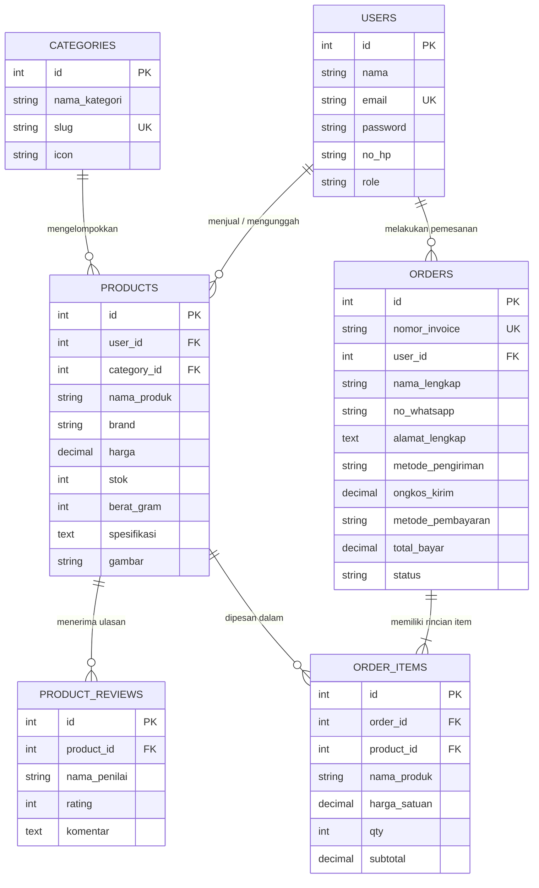
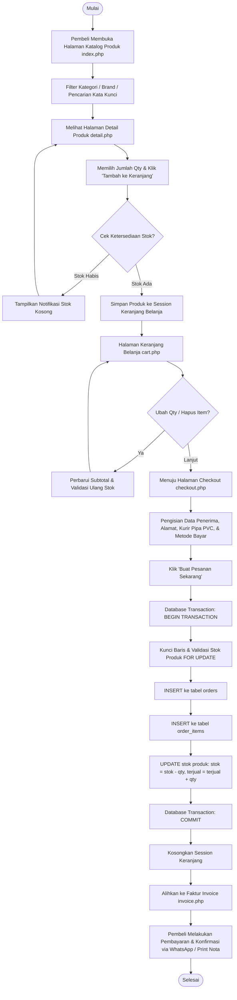

# StrikeZone Fishing Tackle - Marketplace Alat Pancing Tradisional & Modern

Dokumentasi lengkap perancangan, arsitektur database, antarmuka (mockup UI), dan implementasi aplikasi **Web Marketplace Alat Pancing** berbasis **PHP Native**, **MySQLi**, dan **Bootstrap 5**.

Aplikasi ini dapat dijalankan langsung di lingkungan lokal (**XAMPP / MySQL**) maupun dihosting secara online di **InfinityFree**.

---

## DAFTAR ISI
1. [A. Analisis dan Perancangan Sistem](#a-analisis-dan-perancangan-sistem)
   - [a. Identifikasi 5+ Entitas Sistem](#a-identifikasi-minimal-5-entitas)
   - [b. Rancangan Database Relasional (Tabel, Atribut, PK, FK, & Relasi)](#b-rancangan-database-relasional)
   - [c. Entity Relationship Diagram (ERD)](#c-entity-relationship-diagram-erd)
   - [d. Alur Proses Transaksi Pemesanan (Flowchart)](#d-alur-proses-transaksi-pemesanan)
   - [e. Rancangan Antarmuka (Mockup UI)](#e-rancangan-antarmuka-mockup-ui)
2. [B. Implementasi Aplikasi](#b-implementasi-aplikasi)
   - [f. Tumpukan Teknologi (Tech Stack)](#f-tumpukan-teknologi)
   - [g. Realisasi Fitur Utama](#g-realisasi-fitur-utama)
3. [Panduan Menjalankan di Komputer Lokal (XAMPP / MySQL)](#panduan-menjalankan-di-komputer-lokal-xampp--mysql)
4. [C. Panduan Deployment ke Hosting Gratis InfinityFree](#c-panduan-deployment-ke-hosting-gratis-infinityfree)
5. [Struktur Direktori Proyek](#struktur-direktori-proyek)

---

## A. ANALISIS DAN PERANCANGAN SISTEM

### a. Identifikasi Minimal 5 Entitas
Aplikasi marketplace alat pancing ini dirancang menggunakan 6 entitas relasional utama:

1. **`users` (Pengguna / Penjual & Pembeli)**
   - **Peran**: Menyimpan identitas pengguna sistem, membedakan hak akses (`admin` / `seller` / `buyer`), kredensial autentikasi, nomor kontak (WhatsApp), dan alamat.
2. **`categories` (Kategori Alat Pancing)**
   - **Peran**: Mengelompokkan piranti pancing berdasarkan jenisnya (Joran/Rods, Reel, Senar/Line, Umpan/Lure, dan Kail/Aksesoris).
3. **`products` (Katalog Produk Alat Pancing)**
   - **Peran**: Menyimpan data teknis piranti yang ditawarkan penjual, meliputi nama piranti, brand (Shimano, Daiwa, Rapala, Ryobi, dll.), harga, jumlah stok, berat kemasan, spesifikasi teknis (action, drag power, ball bearings, rasio gear), dan foto produk.
4. **`orders` (Transaksi Pemesanan)**
   - **Peran**: Mencatat header transaksi transaksi saat pembeli melakukan pemesanan (Nomor invoice unik, identitas penerima, kurir logistik khusus tabung paralon pipa guard, metode pembayaran, ongkos kirim, total tagihan, dan status pemesanan).
5. **`order_items` (Rincian Item Transaksi)**
   - **Peran**: Menyimpan detail barang dan kuantitas yang dibeli pada setiap nomor transaksi pesanan beserta harga satuan saat transaksi terjadi (*historical snapshot price*).
6. **`product_reviews` (Ulasan & Testimoni Angler)**
   - **Peran**: Menyimpan rating kepuasan (bintang 1–5) dan komentar pengalaman memancing dari pembeli terhadap produk yang dibeli.

---

### b. Rancangan Database Relasional

Berikut rincian tabel, atribut, Primary Key (PK), Foreign Key (FK), dan relasi antar-tabel:

#### 1. Tabel `users`
| Atribut | Tipe Data | Keterangan |
| :--- | :--- | :--- |
| `id` | `INT(11)` | **Primary Key**, Auto Increment |
| `nama` | `VARCHAR(100)` | Nama lengkap pengguna |
| `email` | `VARCHAR(100)` | Alamat email (Unique) |
| `password` | `VARCHAR(255)` | Hash kata sandi aman (Bcrypt) |
| `no_hp` | `VARCHAR(20)` | Nomor kontak / WhatsApp |
| `alamat` | `TEXT` | Alamat domisili |
| `role` | `ENUM('admin','seller','buyer')` | Hak akses pengguna |
| `foto` | `VARCHAR(255)` | Nama file avatar |
| `created_at` | `TIMESTAMP` | Waktu registrasi |

#### 2. Tabel `categories`
| Atribut | Tipe Data | Keterangan |
| :--- | :--- | :--- |
| `id` | `INT(11)` | **Primary Key**, Auto Increment |
| `nama_kategori` | `VARCHAR(100)` | Nama kategori alat (Joran, Reel, dll) |
| `slug` | `VARCHAR(100)` | URL slug unik |
| `deskripsi` | `TEXT` | Penjelasan kategori |
| `icon` | `VARCHAR(50)` | Class icon Bootstrap Icons |
| `created_at` | `TIMESTAMP` | Waktu dibuat |

#### 3. Tabel `products`
| Atribut | Tipe Data | Keterangan |
| :--- | :--- | :--- |
| `id` | `INT(11)` | **Primary Key**, Auto Increment |
| `user_id` | `INT(11)` | **Foreign Key** &rarr; `users(id)` (Penjual) |
| `category_id` | `INT(11)` | **Foreign Key** &rarr; `categories(id)` |
| `nama_produk` | `VARCHAR(200)` | Nama lengkap piranti pancing |
| `slug` | `VARCHAR(220)` | URL slug unik |
| `brand` | `VARCHAR(80)` | Merek pabrikan (Shimano, Daiwa, dll.) |
| `harga` | `DECIMAL(12,2)` | Harga jual produk |
| `stok` | `INT(11)` | Kuantitas stok unit tersedia |
| `berat_gram` | `INT(11)` | Berat paket fisik dalam satuan gram |
| `deskripsi` | `TEXT` | Deskripsi dan ulasan fitur |
| `spesifikasi` | `TEXT` | Rincian teknis (Action, Drag, Bearings) |
| `gambar` | `VARCHAR(255)` | File gambar foto / vektor piranti |
| `rating` | `DECIMAL(2,1)` | Rata-rata skor rating (1.0 - 5.0) |
| `terjual` | `INT(11)` | Akumulasi produk terjual |
| `created_at` | `TIMESTAMP` | Tanggal ditambahkan |
| `updated_at` | `TIMESTAMP` | Tanggal pembaruan terakhir |

#### 4. Tabel `orders`
| Atribut | Tipe Data | Keterangan |
| :--- | :--- | :--- |
| `id` | `INT(11)` | **Primary Key**, Auto Increment |
| `nomor_invoice` | `VARCHAR(50)` | Nomor faktur unik (`INV-YYYYMMDD-XXXXX`) |
| `user_id` | `INT(11)` | **Foreign Key** &rarr; `users(id)` (Nullable) |
| `nama_lengkap` | `VARCHAR(100)` | Nama lengkap penerima kiriman |
| `no_whatsapp` | `VARCHAR(20)` | No. WhatsApp aktif pembeli |
| `email` | `VARCHAR(100)` | Email konfirmasi invoice |
| `alamat_lengkap` | `TEXT` | Alamat tujuan pengiriman paket |
| `kota` | `VARCHAR(100)` | Kota / Kabupaten tujuan |
| `kode_pos` | `VARCHAR(10)` | Kode pos alamat |
| `metode_pengiriman`| `VARCHAR(80)` | Kurir (JNE Paralon, J&T Cargo, SiCepat) |
| `ongkos_kirim` | `DECIMAL(12,2)` | Tarif biaya pengiriman |
| `metode_pembayaran`| `VARCHAR(80)` | BCA, Mandiri, BRI, QRIS, COD |
| `catatan` | `TEXT` | Instruksi khusus pengepakan |
| `total_produk` | `DECIMAL(12,2)` | Total nilai belanja produk |
| `total_bayar` | `DECIMAL(12,2)` | Total tagihan akhir (`total_produk + ongkir`) |
| `status` | `ENUM(...)` | `menunggu_pembayaran`, `diproses`, `dikirim`, `selesai` |
| `created_at` | `TIMESTAMP` | Waktu transaksi dibuat |

#### 5. Tabel `order_items`
| Atribut | Tipe Data | Keterangan |
| :--- | :--- | :--- |
| `id` | `INT(11)` | **Primary Key**, Auto Increment |
| `order_id` | `INT(11)` | **Foreign Key** &rarr; `orders(id)` (ON DELETE CASCADE) |
| `product_id` | `INT(11)` | **Foreign Key** &rarr; `products(id)` (ON DELETE CASCADE) |
| `nama_produk` | `VARCHAR(200)` | Snapshot nama produk saat dibeli |
| `harga_satuan` | `DECIMAL(12,2)` | Snapshot harga satuan produk |
| `qty` | `INT(11)` | Jumlah unit barang yang dipesan |
| `subtotal` | `DECIMAL(12,2)` | `harga_satuan * qty` |

#### 6. Tabel `product_reviews`
| Atribut | Tipe Data | Keterangan |
| :--- | :--- | :--- |
| `id` | `INT(11)` | **Primary Key**, Auto Increment |
| `product_id` | `INT(11)` | **Foreign Key** &rarr; `products(id)` (ON DELETE CASCADE) |
| `nama_penilai` | `VARCHAR(100)` | Nama pengulas / pembeli |
| `rating` | `INT(1)` | Nilai bintang (1 sampai 5) |
| `komentar` | `TEXT` | Testimoni kualitas piranti pancing |
| `created_at` | `TIMESTAMP` | Waktu ulasan dikirimkan |

---

### c. Entity Relationship Diagram (ERD)



---

### d. Alur Proses Transaksi Pemesanan

Berikut tahapan lengkap dari pembeli memilih produk hingga faktur pesanan terbit:



---

### e. Rancangan Antarmuka (Mockup UI)

#### 1. Mockup Halaman: Daftar Produk (`index.php`)
```text
+-------------------------------------------------------------------------------------------------+
| [LOGO STRIKEZONE]  [ Cari joran, reel, lure... ] (Cari)  Semua  Kategori V  [Keranjang: 2] [CRUD]|
+-------------------------------------------------------------------------------------------------+
|  [BANNER HERO]: STRIKEZONE TACKLE - Tackle Berkualitas Tinggi untuk Sensasi Strike Terbaik     |
|  [Gratis Pipa PVC Guard]  [100% Original]  [Pengiriman Seluruh RI]  [Konsultasi Ahli Angler]   |
+-------------------------------------------------------------------------------------------------+
|  Kategori: [Semua] [Joran Pancing] [Reel Pancing] [Senar PE] [Umpan Lure] [Kail & Aksesoris]    |
|  Filter:   Brand: [Semua V] | Urutkan: [Terpopuler V]                    Ditemukan: 12 Produk   |
+-------------------------------------------------------------------------------------------------+
| +---------------------+ +---------------------+ +---------------------+ +---------------------+ |
| | [Gambar Joran Rod]  | | [Gambar Reel 4000]  | | [Gambar Senar PE]   | | [Gambar Lure Rapala]| |
| | SHIMANO [Original]  | | SHIMANO [Hagane]    | | DURAKING [Multicolor| | RAPALA [Deep Diver] | |
| | Shimano Cruzar 2602 | | Stradic FL 4000XG   | | Natuna PE X8 300m   | | X-Rap Magnum 30     | |
| | * 4.9 | 142 Terjual | | * 4.9 | 89 Terjual  | | * 4.9 | 210 Terjual | | * 5.0 | 54 Terjual  | |
| | Rp 385.000 [Stok 25]| | Rp 2.850.000 [Stok 8| | Rp 195.000 [Stok 40| | Rp 235.000 [Stok 18| |
| | [Detail] [ + Beli ] | | [Detail] [ + Beli ] | | [Detail] [ + Beli ] | | [Detail] [ + Beli ] | |
| +---------------------+ +---------------------+ +---------------------+ +---------------------+ |
+-------------------------------------------------------------------------------------------------+
```

#### 2. Mockup Halaman: Detail Produk (`detail.php`)
```text
+-------------------------------------------------------------------------------------------------+
| Beranda > Joran Pancing > Shimano Cruzar 2602 Solid Carbon Rod 180cm                            |
+-------------------------------------------------------------------------------------------------+
| [ GAMBAR PRODUK BESAR ]            | [Kategori: Joran] [Brand: Shimano] [Kode: SKZ-0001]        |
|                                    | Shimano Cruzar 2602 Solid Carbon Rod 180cm                 |
| +--------------------------------+ | Rating: ***** 4.9  |  12 Ulasan  |  142 Terjual            |
| |                                | +----------------------------------------------------------+ |
| |      [ Vektor Visual Rod ]     | | Harga Spesial: Rp 385.000                                 |
| |                                | | Status: [ Stok Siap Kirim (25 Unit) ]                    |
| +--------------------------------+ +----------------------------------------------------------+ |
| [!] Kemasan Tabung PVC Guard Gratis| Jumlah: [-] [ 1 ] [+]    Berat: 450 Gram (Termasuk Tabung) |
|                                    | [ + Tambahkan ke Keranjang ]    [ WhatsApp Konsultasi ]    |
|                                    +----------------------------------------------------------+ |
|                                    | [ Deskripsi ]  [ Spesifikasi Teknis ]  [ Ulasan Pembeli ]  |
|                                    | * Panjang: 180 cm (6.0 ft) | Sambungan: 2 Bagian (Center)  |
|                                    | * Material: Solid Carbon Tangguh & Ring Ceramic Hard       |
+------------------------------------+------------------------------------------------------------+
```

#### 3. Mockup Halaman: Keranjang Belanja (`cart.php`)
```text
+-------------------------------------------------------------------------------------------------+
| Keranjang Belanja Anda                                              [ Kosongkan Keranjang ]    |
+-----------------------------------------------------------------+-------------------------------+
| DAFTAR ITEM PIRANTI                   HARGA    JUMLAH  SUBTOTAL | RINGKASAN BELANJA             |
+-----------------------------------------------------------------+-------------------------------+
| [Foto] Shimano Cruzar 2602 Rod        Rp 385.000 [-][2][+] Rp 770.000| Total Item:   2 Unit            |
| [Foto] Duraking Natuna PE X8 300m     Rp 195.000 [-][1][+] Rp 195.000| Subtotal:     Rp 965.000        |
|                                                                 | Tabung PVC:   GRATIS Rp 0     |
|                                                                 | ----------------------------- |
| [< Kembali Belanja]                   Total Bobot: 1.100 Gram   | Total Tagihan:Rp 965.000        |
|                                                                 | [ Lanjut ke Checkout -> ]     |
+-----------------------------------------------------------------+-------------------------------+
```

---

## B. IMPLEMENTASI APLIKASI

### f. Tumpukan Teknologi
- **Bahasa Pemrograman**: PHP 8.x Native (Procedural & Clean Structured Code).
- **Driver Database**: MySQLi dengan **Prepared Statements** untuk pencegahan SQL Injection dan **Database Transaction** (`mysqli_begin_transaction`, `mysqli_commit`, `mysqli_rollback`).
- **Desain & Gaya Tampilan**: Bootstrap 5.3.3, Bootstrap Icons 1.11.3, Google Fonts (*Plus Jakarta Sans*), dan palet modern *Oceanic Dark Theme* khas piranti laut & kolam pancing.
- **Grafis**: SVG Vector Produk Beresolusi Tinggi terintegrasi yang ringan dan tajam pada segala resolusi layar.

### g. Realisasi Fitur Utama
1. **Daftar Produk (`index.php`)**:
   - Menampilkan katalog piranti pancing dengan filter Kategori, filter Brand, pengurutan harga/populer/rating, dan pencarian kata kunci.
2. **Detail Produk (`detail.php`)**:
   - Menampilkan gambar produk, badge ketersediaan stok, harga Rp, tabel spesifikasi teknis, tab deskripsi keaslian, counter kuantitas, formulir ulasan bintang testimoni, dan rekomendasi piranti sejenis.
3. **Keranjang Belanja (`cart.php`)**:
   - Menambah produk ke session, mengubah kuantitas dengan validasi batas stok gudang, kalkulasi subtotal dan bobot otomatis, serta opsi hapus item / kosongkan keranjang.
4. **Checkout & Penyimpanan Transaksi (`checkout.php`)**:
   - Validasi data alamat pembeli, pilihan kurir (JNE Paralon PVC Guard, J&T Cargo, SiCepat), pilihan pembayaran (BCA, Mandiri, BRI, QRIS, COD), eksekusi database transaction ACID, pemotongan stok otomatis di tabel `products`, dan pencatatan riwayat di `orders` serta `order_items`.
5. **Faktur Invoice Resmi (`invoice.php`)**:
   - Bukti transaksi resmi dengan tombol **Cetak / PDF** (`@media print`) dan tombol konfirmasi otomatis via **WhatsApp API**.
6. **Kelola Produk CRUD Penjual (`admin/`)**:
   - **Create**: Tambah produk pancing baru dengan upload foto atau preset grafis (`admin/produk-tambah.php`).
   - **Read**: Tabel inventaris produk dengan status stok kritis (`admin/produk.php`).
   - **Update**: Edit harga, spesifikasi, dan stok produk (`admin/produk-edit.php`).
   - **Delete**: Hapus produk dari database beserta berkas gambar fisik (`admin/produk-hapus.php`).
   - **Kelola Pesanan**: Pembaruan status pesanan (Menunggu Pembayaran &rarr; Diproses &rarr; Dikirim &rarr; Selesai) (`admin/pesanan.php`).

---

## PANDUAN MENJALANKAN DI KOMPUTER LOKAL (XAMPP / MYSQL)

1. **Jalankan XAMPP Control Panel**:
   - Klik tombol **Start** pada modul **Apache**.
   - Klik tombol **Start** pada modul **MySQL** (hingga indikator berwarna hijau).

2. **Akses Aplikasi melalui Web Browser**:
   - Buka browser (Google Chrome / Edge / Firefox) dan akses salah satu alamat:
     ```text
     http://localhost/web_marketpless
     ```
     *(atau `http://localhost/web_marketpls`)*

3. **Inisialisasi Database (Setup 1-Klik)**:
   - Bila database belum ada, sistem akan menampilkan panduan setup ramah pengguna.
   - Klik tombol **"Jalankan Setup Database Otomatis"** atau buka langsung:
     ```text
     http://localhost/web_marketpless/setup.php
     ```
   - Skrip akan membuat database `db_pancing_marketplace`, membuat seluruh tabel, dan mengisi katalog produk pancing populer secara instan.
   - *Alternatif Manual*: Anda dapat mengimpor file `database.sql` melalui **phpMyAdmin** (`http://localhost/phpmyadmin`).

4. **Kredensial Login Default (Untuk Panel Admin / Penjual)**:
   - **Email Admin**: `admin@strikezone.com`
   - **Password**: `admin123`
   - **URL Panel Admin**: `http://localhost/web_marketpless/admin/index.php`

---

## C. PANDUAN DEPLOYMENT KE HOSTING GRATIS INFINITYFREE

Ikuti langkah mudah berikut untuk mempublikasikan website alat pancing Anda ke internet secara gratis di **InfinityFree**:

### Langkah 1: Pendaftaran Akun InfinityFree
1. Kunjungi situs resmi [https://infinityfree.com](https://infinityfree.com) dan klik tombol **Register Now**.
2. Masukkan alamat email aktif Anda dan buat kata sandi akun, lalu verifikasi email pendaftaran.

### Langkah 2: Buat Hosting Account & Subdomain Gratis
1. Di halaman **Client Area**, klik tombol **Create Account**.
2. Pilih opsi domain gratis (contoh subdomain: `strikezone-pancing.infinityfreeapp.com` atau `toko-pancing-jaya.rf.gd`).
3. Klik **Check Availability** dan lanjutkan pembuatan akun hingga selesai.
4. Tunggu beberapa detik hingga status akun aktif (*Active*).

### Langkah 3: Membuat Database MySQL di vPanel
1. Klik tombol **Manage** &rarr; **Control Panel (vPanel)**.
2. Cari dan klik menu **MySQL Databases**.
3. Di kolom *Create New Database*, masukkan nama database (misalnya: `pancing`).
4. Klik **Create Database**.
5. Catat 4 informasi penting yang tampil di vPanel:
   - **MySQL Hostname**: (Contoh: `sql300.infinityfree.com`)
   - **MySQL Username**: (Contoh: `if0_38123456`)
   - **MySQL Password**: (Kata sandi hosting vPanel Anda)
   - **MySQL Database Name**: (Contoh: `if0_38123456_pancing`)

### Langkah 4: Mengimpor Skrip Database via phpMyAdmin InfinityFree
1. Di halaman vPanel, cari dan klik menu **phpMyAdmin**.
2. Klik tombol **Connect** di sebelah nama database Anda.
3. Di jendela phpMyAdmin, pilih tab **Import**.
4. Klik **Choose File** dan pilih file `database.sql` dari komputer Anda.
5. Klik tombol **Go / Kirim** di bagian bawah. Seluruh 6 tabel dan data awal produk pancing akan terisi otomatis.

### Langkah 5: Mengunggah Source Code ke Folder `htdocs`
1. Kembali ke Client Area InfinityFree, buka **File Manager** (atau gunakan aplikasi FTP seperti **FileZilla** dengan kredensial FTP vPanel).
2. Masuk ke direktori **`htdocs/`**.
3. Unggah seluruh isi file dan folder dari aplikasi (`index.php`, `detail.php`, `cart.php`, `checkout.php`, `invoice.php`, folder `admin/`, `assets/`, `config/`, `includes/`).
   *(Pastikan file `index.php` berada langsung di dalam folder `htdocs/`, bukan di dalam subfolder).*

### Langkah 6: Menyesuaikan Konfigurasi Koneksi Database
Buka file `config/database.php` di File Manager dan sesuaikan bagian *hosting configuration*:
```php
define('DB_HOST', 'sql300.infinityfree.com');      // Ganti dengan MySQL Hostname vPanel Anda
define('DB_USER', 'if0_38123456');                // Ganti dengan MySQL Username Anda
define('DB_PASS', 'KATA_SANDI_VPANEL_ANDA');      // Ganti dengan Password Anda
define('DB_NAME', 'if0_38123456_pancing');        // Ganti dengan Database Name Anda
```
Simpan file tersebut.

### Langkah 7: Pengujian & Selesai
Buka subdomain Anda di browser (contoh: `http://strikezone-pancing.infinityfreeapp.com`). Website marketplace alat pancing Anda sekarang sudah dapat diakses oleh publik di seluruh dunia!

---

## STRUKTUR DIREKTORI PROYEK

```text
web_marketpless/
├── config/
│   └── database.php          # Koneksi MySQLi (Deteksi otomatis Lokal & InfinityFree)
├── includes/
│   ├── header.php            # Navigasi atas, search bar, keranjang pill badge
│   ├── footer.php            # Informasi toko pancing, kontak WA, tautan cepat
│   └── functions.php         # Format Rupiah, session cart, flash alert, sanitasi
├── assets/
│   ├── css/
│   │   └── style.css         # Desain tema Oceanic Dark Theme & print invoice CSS
│   ├── js/
│   │   └── main.js           # Quantity counter, hitung dinamis ongkir, konfirmasi hapus
│   └── img/
│       ├── logo.svg          # Vektor logo StrikeZone Fishing Tackle
│       └── products/         # Berkas foto dan 12+ ilustrasi vektor piranti pancing
├── admin/
│   ├── index.php             # Dashboard ringkasan: omset, total produk, pesanan
│   ├── produk.php            # CRUD Read: Daftar inventaris alat pancing & pencarian
│   ├── produk-tambah.php     # CRUD Create: Formulir penambahan piranti baru & upload
│   ├── produk-edit.php       # CRUD Update: Formulir edit harga, stok, & spesifikasi
│   ├── produk-hapus.php      # CRUD Delete: Hapus produk & pembersihan file fisik
│   └── pesanan.php           # Kelola pesanan & status pengiriman (Diproses/Dikirim)
├── index.php                 # Katalog Utama: Filter kategori, brand, & urutan harga
├── detail.php                # Rincian Produk: Spesifikasi teknis, rating, & ulasan
├── cart.php                  # Keranjang Belanja: Kelola kuantitas & subtotal
├── checkout.php              # Pemesanan: Database transaction ACID & potong stok
├── invoice.php               # Faktur Resmi: Format siap cetak & konfirmasi WhatsApp
├── setup.php                 # Installer 1-Klik Otomatis Database lokal & online
├── database.sql              # Skrip SQL 6 entitas relasional lengkap dengan data awal
└── README.md                 # Dokumentasi sistem, ERD, mockup UI, & deployment
```
